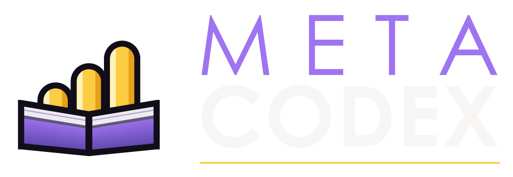

# Showing MetaCodex on stream

**Yes, please — and you do not need to ask.** If you use the addon and
want its mark on your layout, take the files below and put them up. No
fee, no form, no exclusivity, and nothing expected in return.

*[Deutsche Fassung](STREAMERS.de.md)*

---

## The files

All of them are in [`assets/stream/`](assets/stream/). PNG with a
transparent background unless it says otherwise.

| File | For |
|---|---|
| [`mark-1024.png`](assets/stream/mark-1024.png) | The emblem alone, 1024×1024 — a corner, a webcam frame, a stinger |
| [`mark-256.png`](assets/stream/mark-256.png) | The same, small |
| [`logo-on-dark-1024.png`](assets/stream/logo-on-dark-1024.png) | Emblem and wordmark, white type — for dark gameplay |
| [`logo-on-light-1024.png`](assets/stream/logo-on-light-1024.png) | The same with dark type — for light backgrounds |
| [`badge-on-plate-720.png`](assets/stream/badge-on-plate-720.png) | On its own dark plate — for footage too busy for a free-standing mark |
| [`twitch-panel-320.png`](assets/stream/twitch-panel-320.png) | A Twitch panel under your stream, 320×100 |

Which of the two wordmark versions is right is decided by what lies under
it, not by preference. White type on a bright Hallowfall afternoon is
gone; dark type on a dungeon is gone too. If the footage moves too much
for either, use the plate.

## Four rules, and that is all of them

1. **Do not redraw it.** No other colours, no stretching, no outline, no
   drop shadow, no cropping of the emblem. Scale it, that is all.
2. **Give it room.** Keep free space around the logo of at least half the
   emblem's height.
3. **Keep it readable.** The wordmark not below 240 px wide, the emblem
   alone not below 48 px. Below that it is mush, and mush is worse than
   nothing.
4. **Do not make it an endorsement.** Showing the mark says you use the
   addon. It does not say MetaCodex sponsors you, partners with you or
   vouches for you — so please do not word it that way, and do not put it
   on merchandise or anything you sell.

That covers everything we would ever ask about. If something you have in
mind is not in there, it is probably fine; ask only if you want to be
sure.

## If you are building your own overlay

| | |
|---|---|
| Amethyst | `#9E74F0` |
| Gold | `#FCCD42` |
| Night | `#14101E` |
| Paper | `#F8F6F4` |
| Type | Century Gothic, or any geometric sans |

The mark is gold where it means value and amethyst everywhere else. If
you set the name yourself: **META** in the regular weight above **CODEX**
in the bold, both tracked to the same width, with the gold rule under
them.

## Where to send people

* CurseForge — <https://www.curseforge.com/wow/addons/meta-codex>
* Wago — <https://addons.wago.io/addons/4N2bP9NL>
* Source — <https://github.com/Ego26/MetaCodex>

The addon is free and GPL-3.0. There is no premium version, no key, and
nothing to buy, so there is nothing you could accidentally promise your
viewers.

## Questions, or something you need that is not here

A different size, a vertical lockup, a transparent stinger, an animated
version — open an issue at
<https://github.com/Ego26/MetaCodex/issues> and say what you need it for.

---

MetaCodex is not affiliated with Blizzard Entertainment. World of
Warcraft and its assets belong to Blizzard; the mark in this kit does not.
